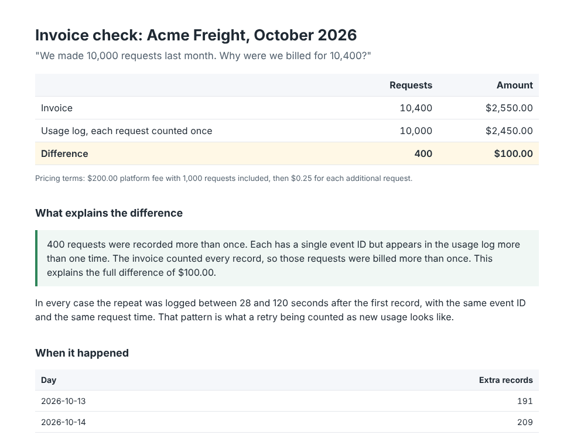

# Usage Invoice Checker

A small tool that answers a billing question software customers ask all the time:

> "We made 10,000 requests last month. Why were we billed for 10,400?"

It takes the raw usage log, the customer's pricing terms and the invoice. It works out what the bill should have been and shows exactly which records explain the difference.



## The sample case

Acme Freight is a made-up customer of a made-up API. They pay $200 a month with 1,000 requests included, then $0.25 for each extra request. For October 2026 they were invoiced $2,550.00 for 10,400 requests. Their own count is 10,000.

What the checker finds:

- 400 requests appear in the usage log twice, each with the same event ID both times.
- The invoice counted every record, so those 400 requests were billed twice.
- All of them happened on October 13 and 14, and each repeat was logged 28 to 120 seconds after the first record. That is what a retry being counted as new usage looks like.
- The correct bill is $2,450.00, so the customer is owed $100.00.

## Run it

```
python3 checker.py
open report.html
```

Nothing to install. It only uses Python's standard library (Python 3.9 or newer).

Other commands:

```
python3 -m unittest -v        # run the tests
python3 make_sample_data.py   # rebuild the sample files in data/
python3 checker.py --usage my_usage.csv --pricing my_pricing.json --invoice my_invoice.csv
```

## How it tells a duplicate from two real requests

Every request has an event ID that the customer's system creates once, when it sends the request. If the same event ID shows up in two records, that is one request recorded twice.

Two requests sent in the same second are a different thing. They have different event IDs, so both are real and both should be billed. The sample data has 30 of these on purpose, and the checker leaves them alone.

This is the query that finds the duplicates:

```sql
SELECT event_id,
       COUNT(*)         AS times_recorded,
       MIN(recorded_at) AS first_recorded,
       MAX(recorded_at) AS last_recorded
FROM usage
GROUP BY event_id
HAVING COUNT(*) > 1
```

## Files

| File | What it does |
| --- | --- |
| `checker.py` | Loads the files into SQLite, runs the checks, prints a summary and writes `report.html` |
| `make_sample_data.py` | Creates the sample usage log, pricing terms and invoice |
| `test_checker.py` | Tests for the pricing math and the duplicate check |
| `data/usage.csv` | 10,400 usage records |
| `data/pricing.json` | The customer's pricing terms |
| `data/invoice.csv` | The invoice the customer received |

## Limits

- It handles one customer, one month and one pricing rule.
- It trusts the event ID. If a customer's system reused an ID for two different requests, the checker would wrongly call them one request.

## Why this problem

At work I helped set pricing based on volume. Bills based on usage are hard for a customer to check, and "why is my bill higher than my usage?" needs an answer backed by the records.

## How it was built

Python and SQLite, built with AI-assisted development (Claude Code).
